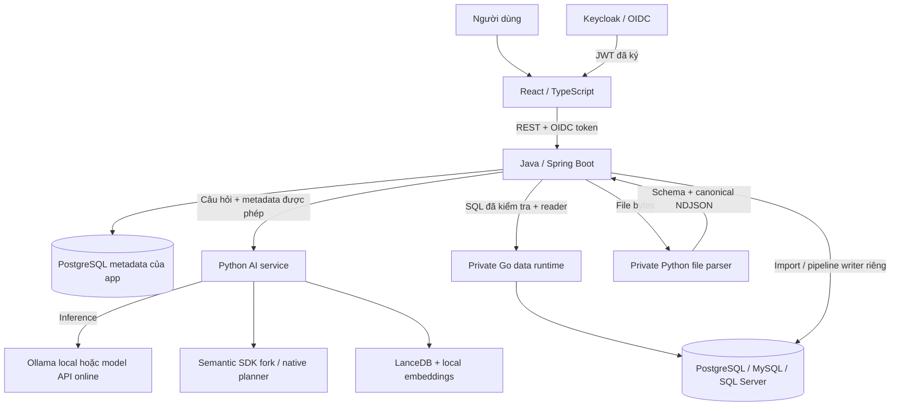

# Làm chủ application Text-to-SQL: kiến trúc, engine, AI và dữ liệu

Tài liệu đọc theo code trên nhánh `module/production-readiness`, cập nhật ngày 22/10/2026. Mục tiêu là giải thích **vì sao từng lớp tồn tại, dữ liệu đi qua đâu và lớp nào bảo đảm điều gì**. Kết quả nghiệm thu và giới hạn hiện hành nằm ở [project status](project-status.md), [work log](work-log.md) và [acceptance](acceptance.md). Một ví dụ SQL trong tài liệu là ví dụ giải thích, không phải đáp án được cài vào runtime.

[Phát triển schema docs và semantic layer](schema-and-semantic-development.md) đi sâu quy trình discovery → tài liệu runtime → metric/dimension/join/rule → validate/activate/version → indexing/evaluation, kèm ví dụ definition và giới hạn hiện hành.

## 1. Application thực sự làm việc gì?

Bạn có database, nhưng người hỏi thường biết nghiệp vụ hơn SQL. “Doanh thu theo quốc gia” còn thiếu nhiều quyết định: doanh thu trước hay sau giảm giá, ngày đặt hay ngày giao hàng, quốc gia khách hàng hay lãnh thổ bán hàng, có tính đơn hủy không? Biết tên cột chưa đủ để trả lời đúng.

Application kết nối bốn việc:

1. Đăng ký và khám phá dữ liệu được phép sử dụng.
2. Quản lý định nghĩa nghiệp vụ dùng chung.
3. Chuyển câu hỏi hoặc lựa chọn nghiệp vụ thành SQL có thể kiểm tra.
4. Thực thi có giới hạn trên database thật và trình bày kết quả có nguồn gốc.

LLM giúp hiểu cách diễn đạt. Compiler giúp biến cấu trúc đã xác định thành SQL. Validator và quyền database kiểm soát việc được thực thi. Database mới là nơi tính kết quả cuối cùng. Các việc này có trách nhiệm khác nhau; gọi model giỏi hơn không loại bỏ nhu cầu của các lớp còn lại.

Ba khái niệm xuyên suốt:

| Object    | Ý nghĩa                                                                                                        | Ví dụ                                           |
| --------- | -------------------------------------------------------------------------------------------------------------- | ----------------------------------------------- |
| Warehouse | Bản đăng ký kết nối tới database/warehouse đã tồn tại, gồm engine, endpoint, database và tham chiếu credential | Một kết nối PostgreSQL tới database của công ty |
| Dataset   | Phạm vi logic trong Warehouse: bảng/schema được phép dùng, ngữ nghĩa và phiên bản                              | Chỉ dữ liệu bán hàng, không gồm bảng nhân sự    |
| Query     | Một lần xử lý có danh tính, câu hỏi/lựa chọn, trạng thái, SQL, model, phiên bản và snapshot kết quả            | Lần hỏi doanh thu vào lúc 10:00                 |

Dataset không mặc nhiên là database mới và không sao chép mọi dòng về app. Hai Dataset có thể dùng cùng Warehouse với allowlist hoặc định nghĩa khác nhau. Không được suy dialect từ câu chữ của người hỏi: Java lấy engine từ Warehouse và kiểm tra Dataset thực sự thuộc Warehouse đó.

## 2. Bản đồ kiến trúc đang triển khai



Các mũi tên có ý nghĩa về quyền:

- Browser chỉ gọi API Java. Browser không giữ password warehouse, không gọi private Python/Go.
- AI service nhận metadata, câu hỏi và cấu hình model qua kênh private; không nhận credential warehouse và không thực thi SQL vào warehouse.
- File parser nhận bytes file để giải mã, không nhận credential warehouse và không gọi LLM.
- Go executor nhận reader credential trên kênh private để đọc dữ liệu bằng driver/pool thật. Go executor khác AI service.
- Java quyết định quyền, kế hoạch, credential nào được dùng, SQL nào được chạy, dữ liệu nào được lưu và trả về.

PostgreSQL metadata là database quản trị của app. Nó lưu registry, grants, semantic definitions, history, run/job, audit, model profiles… Warehouse là database nguồn phân tích. Chọn PostgreSQL để lưu metadata không ép Warehouse phải là PostgreSQL. Flyway migrate metadata của app; nó không tự migrate mọi warehouse đã đăng ký.

### Vì sao không để React gọi thẳng Python hoặc database?

Nếu React tự gửi SQL/credential, quyền truy cập, giới hạn và lịch sử sẽ bị phân tán. Nếu Python tự quyết định SQL nào được chạy, một lỗi model hoặc prompt injection có thể biến thành quyền database. Java tạo một ranh giới kiểm soát chung, kể cả khi nguồn SQL là LLM, example offline hay compiler nghiệp vụ.

Đổi model không cần viết lại UI/database adapters. Đổi engine không cần viết lại màn truy vấn. Đổi cách nạp file không được thay quyền thực thi SQL. Đây là lợi ích thực tế của việc tách lớp.

## 3. FE được tổ chức như thế nào?

Điểm bắt đầu: [App.tsx](../frontend/src/App.tsx), [auth.tsx](../frontend/src/app/auth.tsx), [providers.tsx](../frontend/src/app/providers.tsx).

### 3.1. Shell, route và state

Shell dùng sidebar navy, active blue, selectors Warehouse/Dataset và các card/table theo ảnh tham chiếu. Route mô tả chức năng: Query, History, Catalog, Semantic, Knowledge, Pipelines, Quality, Ingestion, SQL Import, Warehouses, Monitoring, Settings. Các tab kết quả đọc cùng một Query snapshot; không chạy lại model mỗi lần đổi tab.

React state giữ trạng thái tương tác như modal đang mở, bộ lọc, draft và lựa chọn chart. TanStack Query quản lý dữ liệu server, query keys, loading/error, cache và invalidation. Warehouse/Dataset là context chung; đổi context phải bỏ draft/preview không còn hợp lệ. Cache được xóa khi đổi danh tính để tránh hiển thị dữ liệu của tài khoản trước.

Zod kiểm tra response tại runtime. TypeScript giúp lúc viết code, nhưng response HTTP đến từ bên ngoài vẫn có thể sai. Nếu contract không khớp, FE báo `CONTRACT_MISMATCH`; không tự điền số liệu demo cho đủ màn hình.

### 3.2. API client

[client.ts](../frontend/src/api/client.ts) gắn bearer token và correlation ID, quản lý timeout/cancellation, kiểm tra đường dẫn, giới hạn response và chuẩn hóa lỗi. Các file `*Api.ts` tách cách gọi endpoint khỏi component.

Abort request khi đổi route/context giúp tránh một response cũ cập nhật nhầm màn mới. Abort ở browser không tự chứng minh transaction ở server đã rollback; vì vậy timeout có hướng dẫn kiểm tra history trước khi gửi lại. Một thao tác ghi có thể đã hoàn thành trước khi đường truyền bị ngắt.

### 3.3. Biểu đồ và bảng lấy từ đâu?

[Visualization.tsx](../frontend/src/components/Visualization.tsx) và [ResultTable.tsx](../frontend/src/components/ResultTable.tsx) dùng cột, kiểu và giá trị của kết quả thật. Chart recommendation là gợi ý, phải tương thích với output. Một dòng/một cột số phù hợp KPI. Một cột phân loại và một số đo có thể vẽ cột/tròn. Dữ liệu thời gian có thể vẽ đường/diện tích. Nhiều series chỉ ghép khi units đã biết và phù hợp; mã khóa số không tự trở thành metric.

FE dùng Recharts để vẽ, không nhờ model tạo ảnh biểu đồ. Model có thể đề xuất `x` và `series`, nhưng không được bịa dòng để lấp biểu đồ. SQL hiển thị được format nhiều dòng và tô màu; thao tác copy giữ SQL gốc, không copy phiên bản đã trình bày lại.

Response Query ban đầu thường chỉ kèm20dòng preview. Overview/Visualization đọc các trang snapshot đã lưu khi cần, tối đa1.000dòng/5MiB; không gọi lại model/warehouse để dựng chart. Ví dụ24nhóm phải vẽ đủ24, không chỉ20nhóm đầu. Phạm vi lớn hơn giới hạn chart được thông báo, paging lỗi/hết hạn phải báo lỗi thay vì vẽ một phần như đã đủ. Bảng và CSV vẫn đọc snapshot theo policy riêng.

BIGINT/DECIMAL thường đi qua JSON dưới dạng chuỗi để không mất độ chính xác của JavaScript Number. Giá trị chính xác trong bảng/copy/CSV và số gần đúng cần cho chart có vai trò khác nhau. Không lấy số đã làm tròn trên chart làm dữ liệu tính kế toán.

Các component chung xử lý labels, focus, keyboard, modal, listbox, paging và bảng cuộn. Accessibility không chỉ là màu đẹp: người dùng cần chọn dataset bằng bàn phím, thoát modal bằng Escape, biết focus đang ở đâu và đọc tên control bằng trình đọc màn hình.

## 4. BE là nơi điều phối và kiểm soát

Java không chỉ chuyển tiếp câu hỏi sang Python. Các lớp đáng đọc:

| Nhóm                | File chính                                                                                         | Công việc                                                                 |
| ------------------- | -------------------------------------------------------------------------------------------------- | ------------------------------------------------------------------------- |
| Public API/security | `Security`, các `*Controller`, `Errors`                                                            | Xác thực, role/resource authorization, request validation, safe errors    |
| Registry/catalog    | `RegistryController`, `CatalogService`, `warehouse/*`                                              | Kết nối, discovery schema/cột/PK/FK/comments, allowlist, semantic context |
| Query               | `QueryService`, `AiClient`, `SemanticPlannerClient`, `SqlGuard`                                    | Chọn mode/provider, candidate, native plan, guard/lineage, thực thi       |
| Tài nguyên          | `QueryAdmission`, `QueryDeadline`                                                                  | Chặn quá tải, giới hạn thời gian và interruption                          |
| Lưu trữ             | `Store`, Flyway migrations                                                                         | Metadata, grants, query/run snapshots, audit                              |
| Model               | `ModelProviderService`, `ModelProviderPolicy`, `ModelProviderSecrets`                              | Profile, default/revision, URL policy, key encryption                     |
| SQL import/file     | `SqlImport*`, `FileIngestion*`, `FileParserClient`, `FileTypes`                                    | Parse/preview/confirm/job/batch/persistence                               |
| Data pipelines      | `IngestionSourceService`, `PipelineService`, `TransformationPipelineService`, `TransformationData` | Nguồn tổng quát, các lớp biến đổi, run/idempotency                        |
| Quality/evaluation  | `DataQuality*`, `Evaluation*`, `DatasetEvaluation`                                                 | Phép kiểm dữ liệu và so sánh query với oracle                             |

Các tên trên trỏ tới package [dev/nla](../backend/src/main/java/dev/nla). API/client trong Java chưa phải ranh giới bảo mật cuối: credential database và các dịch vụ private vẫn phải được giới hạn riêng.

### Một request tự nhiên đi hết hệ thống

Theo [QueryService.java](../backend/src/main/java/dev/nla/QueryService.java):

1. Kiểm tra fields, question length, mode, provider và quan hệ Warehouse–Dataset.
2. Kiểm tra quyền, trạng thái ACTIVE và nhận admission slot. Quá tải bị từ chối trước khi gọi model/tạo query history.
3. Tạo Query RUNNING, bắt đầu deadline và lấy context từ physical metadata + semantic active.
4. Chọn provider hoặc offline/compiler theo mode; private Python trả candidate.
5. Kiểm tra các tên metric/dimension candidate nhắc đến thuộc context.
6. Java tạo manifest được cấp phép và gọi native semantic planning.
7. `SqlGuard` parse/resolve SQL sau planning; so tập nguồn vật lý với lineage planner trả về.
8. Kiểm tra lại quyền và cấu hình hiện hành. Nếu quyền bị thu hồi hoặc Dataset/Warehouse đổi trong lúc chờ inference, không dùng snapshot cũ để thực thi.
9. Adapter thực thi bằng reader với giới hạn rows/bytes/time; lấy kết quả thật.
10. Annotate presentation/units, kiểm chart, lưu SUCCESS hoặc trạng thái lỗi cùng snapshot, trả public response an toàn và giải phóng admission.

Public response có thể trả một Query mang trạng thái lỗi sau khi request đã được chấp nhận. HTTP thành công không có nghĩa SQL thành công: phải đọc `status`, `error`, `result` và provenance.

## 5. Các phương án “gọi AI” thực chất là gì?

| Lựa chọn                | Có gọi model sinh SQL? | Cách vận hành                                                                                |
| ----------------------- | ---------------------- | -------------------------------------------------------------------------------------------- |
| AUTO                    | Có                     | Dùng profile mặc định hiện hành, ghi rõ loại và model                                        |
| API/chọn model          | Có                     | Dùng providerId được chọn; profile có thể ONLINE hoặc OLLAMA                                 |
| DETERMINISTIC / Offline | Không                  | Khớp câu hỏi đã chuẩn hóa với semantic example đúng dataset/dialect, dùng SQL được cấu hình  |
| SEMANTIC / chọn metrics | Không                  | Business compiler biên dịch metrics/dimensions/filters thành SQL theo quy tắc                |
| AI đề xuất ngữ nghĩa    | Có                     | Model đề xuất bản nháp definitions, compiler/Java kiểm; admin review/validate/activate riêng |
| Embedding cho tri thức  | Có model embedding     | Biến metadata/câu hỏi thành vectors để retrieval; không trực tiếp sinh SQL                   |

“API” trong tên mode là cách app gọi một model server qua HTTP, không đồng nghĩa “model online phải trả phí”. Ollama cũng cung cấp HTTP API trên máy local. Cùng client tương thích Chat Completions có thể gọi online hoặc Ollama với profile khác nhau.

### 5.1. Ollama local

Ollama phục vụ model đã tải trên máy. `qwen3:4b` là model sinh câu trả lời/SQL đang dùng để kiểm thử local; `embeddinggemma:300m` phục vụ embeddings. Python gửi prompt qua endpoint đã cấu hình, nhận JSON, kiểm tra candidate rồi trả Java. Docker dùng host endpoint phù hợp thay vì nhầm `localhost` của container với máy chủ.

Đây là **inference bằng model pretrained**. Dự án chưa train/fine-tune model trên Chinook. Việc hỏi câu mới được không phụ thuộc vào có một câu giống hệt trong code; nó phụ thuộc model hiểu câu hỏi và context tới đâu. Model nhỏ vẫn có thể sai grain, bỏ điều kiện hoặc timeout. “Chạy local” không đồng nghĩa “luôn đúng” hoặc “không có model”.

Profile local được dùng cho corpus đợt này có structured JSON output, `reasoning_effort=none`, output budget1536tokens và generation budget30s. Mục đích là hạn chế thời gian thinking/output; không bảo đảm mọi câu đều hoàn tất. Cách Ollama ánh xạ reasoning effort phụ thuộc model/version; tham khảo [tài liệu chính thức](https://github.com/ollama/ollama/blob/main/docs/api/openai-compatibility.mdx), không áp dụng cấu hình này máy móc cho provider online khác.

Sau QA này, query thật trên Ollama cho thấy câu đếm đơn giản hoàn tất trong khoảng19s nhưng một gợi ý xu hướng từ cột vật lý có thể vượt35s khi model cần xử lý grain và một lần correction. Profile local hiện cấp tối đa55s cho mỗi request provider và generation chung tối đa50s; Java vẫn giữ query deadline60s. Đây là nới timeout có giới hạn để local model hoàn tất một candidate/correction, không bảo đảm câu hỏi mơ hồ sẽ được chấp nhận hoặc kết quả đúng.

### 5.2. Model online

Admin quản lý profile trong Settings: tên, loại, base URL, model, key, enabled/default. Java lưu key bằng AES-GCM trong metadata; master key nằm riêng ngoài DB/Git. Public API chỉ trả metadata an toàn, không trả lại key, suffix hoặc ciphertext. Đổi revision chống ghi đè cấu hình đồng thời.

Java chọn profile cho từng request và truyền cấu hình trusted qua private HTTP; Python dùng request scope, không thay biến global cho mọi người. Prompt gửi provider chứa câu hỏi và metadata đã chọn; key chỉ dùng ở Authorization header. Warehouse password không nằm trong đó.

Online inference hiện **NOT RUN theo yêu cầu giữ nguyên cấu hình online**. Cơ chế client/profile đã có test, nhưng test transport hoặc thành công Ollama không chứng minh mọi provider online tương thích. Base URL/model/key đúng, protocol, quota và khả năng JSON output của provider vẫn cần nghiệm thu thật khi được phép.

### 5.3. Offline deterministic

`DeterministicModelClient` tìm example theo câu hỏi được chuẩn hóa và dialect. Nó không tải một “model deterministic”, không tự suy luận câu mới và không tự thay AI khi model lỗi. Tên provenance `deterministic-semantic-examples` là nhãn implementation, không phải tên LLM.

Mục đích: tái lập một câu đã duyệt, demo offline đúng phạm vi và kiểm planner/database độc lập với biến động model. Gợi ý câu hỏi trong UI không luôn là example offline: gợi ý từ schema chỉ tạo câu hỏi từ bảng/cột thật; khi gửi AUTO vẫn gọi model.

### 5.4. Structured semantic query

Bạn chọn metric `internet_revenue`, dimension `country`, filter và limit bằng controls. Ý định đã có cấu trúc nên không cần LLM đoán câu chữ. `BusinessCompiler` biên dịch selection theo definitions/relationships được duyệt. Provenance `semantic-compiler` mô tả đường xử lý, không phải model AI.

Đường này hữu ích cho báo cáo ổn định, metric thống nhất và giao diện khám phá dữ liệu có kiểm soát. Nó vẫn phải qua native planner, guard, quyền và database; compiler không được miễn kiểm tra vì là code của mình.

Giới hạn cần hiểu đúng: selection hiện chưa có trường ranking/orderBy. Business compiler sắp xếp theo dimensions tăng dần rồi áp limit; đặt limit=3 **không có nghĩa top3 theo doanh thu**. Top-N nghiệp vụ hiện đi qua câu hỏi tự nhiên và SQL có ORDER BY đúng số đo; không quảng cáo limit của structured explorer như tính năng ranking đã có.

## 6. Python AI service chọn context và gọi model thế nào?

Điểm đọc: [app.py](../ai-service/app.py), [context_index.py](../ai-service/context_index.py), [schema_relevance.py](../ai-service/schema_relevance.py), [knowledge.py](../ai-service/knowledge.py), [candidate_validation.py](../ai-service/candidate_validation.py).

### Metadata thay cho toàn bộ dữ liệu

Java gửi snapshot gồm bảng/cột/kiểu, metrics, dimensions, relationships, business rules, examples, schema/semantic versions, timezone và referenceTime. Không gửi hàng kết quả warehouse hay credential. Model tạo câu SQL để database tính; nó không cộng tổng doanh thu bằng cách đọc hết các dòng trong prompt.

Selector tìm anchor trong tên bảng/cột/synonyms/metrics/dimensions, giữ đường join cần thiết và examples đúng dialect. Chỉ mục lexical giúp tránh parse lại toàn bộ metadata mỗi lần. Khi knowledge index hiện hành sẵn sàng, vector retrieval bổ sung các mục liên quan; examples được nhớ phải được kiểm lại.

Context quá lớn gây chi phí, latency và nhiễu. Chọn ít nhưng phải đủ liên kết. Nếu giữ một bảng fact mà bỏ dimension cần join, prompt ngắn hơn nhưng bài toán đã bị làm sai. Vì vậy selector phải giữ closure các anchor/join; nếu không vừa ngân sách thì trả lỗi có kiểm soát.

Giới hạn mặc định hiện kiểm toàn request UTF-8 khoảng48.000bytes, gồm prompt/schema/context, không phải token counter chính xác của từng model. Không thể từ con số bytes kết luận chi phí token. Cache metadata/session giảm xử lý cục bộ; chỉ khi đo request/provider usage mới kết luận tiết kiệm inference cost.

### Retrieval, few-shot và training khác nhau

- **Retrieval/RAG:** tìm metadata/ví dụ liên quan ở thời điểm hỏi, đưa vào context. Thay definition có thể có tác dụng sau khi cập nhật index; không thay trọng số model.
- **Few-shot:** cho model xem vài cặp question/SQL hợp lệ để học cách trả lời trong request hiện tại.
- **Training/fine-tuning:** tối ưu trọng số model bằng tập train riêng. Luồng đó chưa được triển khai trong application hiện tại.
- **Corpus:** tập bài kiểm hoặc dữ liệu có tổ chức. Có corpus để đánh giá không đồng nghĩa đã dùng nó train model.

Knowledge dùng MemoryStore/schema indexer từ source kit và LanceDB persistent. Namespace được phân vùng theo warehouseId/datasetId/dialect; fingerprint nội dung gồm manifest, examples và embedding model. Manifest hiện chứa cả semanticVersion/schemaVersion, nên đổi phiên bản cũng làm fingerprint đổi và cần rebuild như khi đổi nội dung. Metadata đổi thì index cũ STALE; không coi index cũ là nguồn sự thật. Chỉ mục lưu metadata/ví dụ, không phải bản sao toàn warehouse. Phê duyệt một Query SUCCESS làm example là quyết định quản trị; SUCCESS chỉ nói SQL chạy được, người duyệt vẫn phải kiểm đúng nghiệp vụ.

### Candidate có tám field

`sql`, `explanation`, `assumptions`, `selectedMetrics`, `selectedDimensions`, `chartRecommendation`, `confidence`, `model`.

JSON Schema/Pydantic kiểm hình dạng; validator kiểm tên/tham chiếu/dialect/aliases và policy; kiểm aggregate xét scope/GROUP BY. Python có kiểm chart references theo context/aliases; Java còn phải kiểm với cột kết quả thực sau execution, không suy ra mọi chart đúng chỉ từ Python. Model được yêu cầu trả lời giải thích cùng ngôn ngữ câu hỏi, giữ nguyên identifiers. `confidence=0.9` là self-report có ràng buộc, **không phải xác suất90% đã được hiệu chỉnh** và không thay quyền/guard.

Một candidate sai aggregate grain hoặc chart alias được phép tối đa một correction với cùng model/context trong cùng ngân sách. Không tạo vòng lặp “cứ gọi đến khi đúng”, không retry mọi network/provider/security error và không tự sửa GROUP BY để đoán nghiệp vụ. Sửa lần hai vẫn phải qua toàn bộ checks.

## 7. Core engine giải quyết SQL và bài toán phân tích

### 7.1. Metric, dimension, grain và semantic layer

**Metric** là số đo có định nghĩa: tên, biểu thức aggregate, đơn vị, bảng nguồn và dimensions tương thích. Ví dụ `SUM(FactInternetSales.SalesAmount)` khác `SUM(FactResellerSales.SalesAmount)` dù đều gọi “doanh thu”. Mô tả/synonyms là cấu hình do người quản trị/owner duyệt, không phải sự thật model tự biết.

**Dimension** là chiều phân tích, chẳng hạn quốc gia, danh mục hoặc năm. “Doanh thu theo quốc gia” nghĩa là chia các bản ghi thành nhóm theo dimension rồi tính metric từng nhóm. Khóa khách hàng dùng để định danh một entity; tên khách hàng dùng hiển thị; hai thứ không thay nhau trong mọi GROUP BY.

**Grain/mức hạt** trả lời: một dòng đại diện cho cái gì? Một đơn hàng, một dòng đơn hàng, một khách hàng hay một ngày–sản phẩm? Một fact ở mức dòng hàng không có cùng grain với fact thanh toán. Nếu join trực tiếp hai fact theo customer rồi SUM, có thể nhân số dòng và thổi phồng doanh thu.

**Semantic layer** là cấu hình nối ngôn ngữ nghiệp vụ với cấu trúc vật lý. Nó tập trung công thức, units, synonyms, join/cardinality, rule và phiên bản thay vì để từng prompt tự đoán. Schema cho biết cột `Amount` tồn tại; semantic cho biết `Amount` là tiền trước thuế, được cộng theo ngày nào và dùng với dimensions nào.

Metadata chưa có ngữ nghĩa thì app vẫn có thể hỏi schema/count và model đọc physical metadata. App không được tự coi tên cột là định nghĩa nghiệp vụ đã được xác nhận. File vừa import tạo Dataset có provenance và semantic rỗng, không tự thêm “doanh thu” vào cột số bất kỳ.

### 7.2. Join, cardinality và tránh double-count

Giả sử một đơn có tổng100 và ba dòng hàng. Join Orders→OrderItems tạo ba dòng chứa tổng100; `SUM(Orders.total)` thành300. SQL vẫn chạy, chỉ sai nghĩa. `SUM(DISTINCT total)` cũng không phải cách sửa tổng quát: hai đơn khác nhau cùng100 sẽ bị gộp thành100.

Compiler xây graph quan hệ từ metadata đã kiểm. Đường từ fact tới dimension MANY_TO_ONE thường giữ grain của fact. Đường ONE_TO_MANY có nguy cơ nhân grain. Quan hệ one-side cần PK vật lý hoặc bằng chứng uniqueness có giới hạn khi validate; đó không phải bảo đảm dữ liệu không thể đổi trong tương lai.

Business compiler hiện dùng đường join an toàn, từ chối đường mơ hồ và không ghép metrics khác fact grain khi chưa có kế hoạch bảo toàn grain. Nếu có ba FK OrderDate/DueDate/ShipDate cùng trỏ DimDate, “doanh thu theo năm” chưa đủ để mặc nhiên chọn một vai trò ngày. Không đổi error thành tổng sai để làm màn hình chạy.

Rule bằng văn bản giúp model hiểu nghiệp vụ; nó không tự trở thành constraint cưỡng chế trong compiler. Muốn bảo đảm bằng máy, phải có structured definition và logic kiểm tra tương ứng. SQL arbitrary do LLM tạo không được chứng minh đúng mọi nghiệp vụ chỉ bằng native planning/guard; phải đối chiếu oracle hoặc review.

### 7.3. Top-N: không chỉ thêm LIMIT

“Top3 bản nhạc bán nhiều nhất” cần quyết định entity, số đo, aggregate, filter, order và tie policy.

Ví dụ minh họa theo tên/kiểu Chinook trên SQL Server:

```sql
SELECT TOP 3
    t.TrackId,
    t.Name,
    SUM(il.Quantity) AS quantity_sold
FROM dbo.Track AS t
JOIN dbo.InvoiceLine AS il ON il.TrackId = t.TrackId
GROUP BY t.TrackId, t.Name
ORDER BY quantity_sold DESC, t.TrackId ASC;
```

Nếu chỉ GROUP BY `Name`, hai TrackId trùng tên bị cộng chung thành một bản nhạc. Nếu không có tie-break, hai dòng bằng điểm có thể thay thứ tự giữa các lần chạy/engine. PostgreSQL/MySQL dùng LIMIT ở cuối thay TOP; việc thay cú pháp giới hạn không sửa được grain sai từ trước.

Hiện app xử lý bằng hướng dẫn model giữ key và display name, metadata PK, validation aggregate, compiler grain và test bằng oracle có duplicate/ties. **Hướng dẫn prompt không là chứng minh toán học**: nếu SQL group theo tên vẫn hợp lệ cú pháp nhưng sai ý định thì model có thể lọt qua một số checks. Corpus thực phải bắt trường hợp đó. Không tự thêm cột output hoặc dùng DISTINCT tùy tiện để làm kết quả giống đáp án.

Đợt readiness thêm predicate AST cho trường hợp hẹp: câu hỏi yêu cầu tie-break bằng một primary key đơn rõ ràng và metadata xác định duy nhất key đó. Với outer aggregate trực tiếp, check yêu cầu group/order giữ identity, thứ tự khóa và chiều sắp xếp phù hợp; nhận alias nhưng không đọc nhầm chuỗi literal thành yêu cầu. Composite PK, scope lồng hoặc tên mơ hồ nằm ngoài predicate này. Lỗi có thể dùng một correction đã giới hạn; check không tự viết lại SQL. Đây chưa phải validator hiểu mọi ý định tự nhiên hoặc mọi top-N. Một follow-up thực vẫn FAIL vì model trả thêm ID ngoài hai cột người hỏi yêu cầu, dù entity và tie-break đã đúng.

“Lấy đúng3dòng” khác “lấy mọi entity đồng hạng top3”. Trường hợp thứ hai có thể cần `DENSE_RANK`/`RANK` và trả nhiều hơn3dòng. Đây là ý nghĩa câu hỏi, không chỉ là khác cách format SQL. Limit bảo vệ tài nguyên của app lại là giới hạn vận hành riêng, không được giả làm top-N nghiệp vụ.

### 7.4. Tiếng Việt không dấu, typo và mơ hồ

`normalize_text` chuẩn hóa Unicode/case, bỏ dấu và xử lý `đ` để tăng khả năng so khớp. “tổng doanh thu”, “tong doanh thu” và các synonyms được đưa về dạng so sánh phù hợp. Chuẩn hóa phục vụ tìm context; không đổi tên physical table thành tên đã bỏ dấu để chạy SQL.

Identifier matching nhận tên bảng đủ điều kiện schema, tên compound và typo gần nếu đủ rõ. `albummm` có thể được gợi về `Album` khi đó là ứng viên duy nhất phù hợp; assumptions phải ghi nhận diễn giải. Nếu hai schema có bảng Album, hoặc hai tên gần ngang nhau, hệ thống từ chối mơ hồ thay vì chọn bảng đầu danh sách.

Đây là matching bảo thủ cộng khả năng ngôn ngữ của LLM, không phải dictionary vô hạn cho mọi lỗi chính tả. “Không dấu” cũng không loại bỏ mơ hồ: `ma` có nhiều nghĩa; synonyms/semantic context mới cung cấp ý nghĩa. Câu hỏi không đủ rõ có thể bị controlled error, model timeout hoặc sai intent; ghi đúng loại lỗi trong đánh giá.

### 7.5. Aggregate, NULL, tiền và thời gian

- `COUNT(*)` đếm dòng; `COUNT(column)` bỏ NULL; `COUNT(DISTINCT customer_id)` đếm khách khác nhau. Chúng không thay nhau được.
- `SUM/AVG` bỏ NULL theo hành vi SQL; nhóm không có dữ liệu khác nhóm có tổng0. Không tự `COALESCE(...,0)` nếu chưa có quyết định nghiệp vụ.
- AVG order value phải tính theo grain đơn hàng. AVG giá trị dòng hàng không tự là trung bình đơn hàng; AVG của các AVG ngày cũng không tự bằng AVG toàn bộ.
- DECIMAL/BIGINT cần giữ chính xác xuyên parser→writer→driver→JSON→CSV. Chuyển sang float có thể làm lệch tiền hoặc integer lớn. Mỗi engine có precision/type mapping và giới hạn riêng.
- “Tháng9” cần năm; “tháng này” cần timezone/referenceTime. Cửa sổ `[đầu tháng, đầu tháng sau)` tránh bỏ sót phần thời gian của ngày cuối. Ngày đặt hàng và ngày giao hàng là hai dimensions khác nhau.
- Collation và phân biệt hoa/thường có thể khác engine. Không tự ép mọi chuỗi về một nghĩa để làm test PASS.

Validator aggregate kiểm các scope SELECT/CTE/subquery riêng: biểu thức không aggregate cần phù hợp GROUP BY, window aggregate có semantics khác aggregate thường. Điều đó bắt nhiều lỗi SQL nhưng chưa chứng minh khoảng thời gian hay công thức đã đúng ý người hỏi.

### 7.6. AST và dialect

AST là cây cấu trúc của SQL. Thay vì tìm chữ `DELETE` bằng regex, parser hiểu node SELECT, CTE, function, subquery, column, table… Một câu mở đầu SELECT vẫn có thể chứa nhánh nguy hiểm hoặc truy cập ngoài allowlist; phải xét cây lồng nhau.

Python/SDK dùng SQLGlot cho parse/resolve/rewrite; Java có guard độc lập. Enum chỉ có POSTGRESQL, MYSQL, SQL_SERVER; mỗi adapter/dialect xử lý quote, limit, kiểu, metadata và thực thi cụ thể. Interface có ba implementation thật; thêm enum engine mới mà chưa có các implementation/checks tương ứng không tạo ra support mới.

Guard kiểm read-only SELECT/CTE SELECT, số statements, nguồn/cột hợp lệ, các construct/hàm bị cấm và lineage. DB reader là lớp bảo vệ bổ sung. “Read-only” không đồng nghĩa truy vấn rẻ: SELECT cross join lớn vẫn có thể tốn tài nguyên, nên còn timeout/row/byte/concurrency bounds.

## 8. Candidate SQL, compiler SQL, planned SQL và SQL đã thực thi

Đây là điểm dễ nhầm nhất. Chúng không phải bốn đáp án khác nhau được tạo cho đẹp UI.

| Dạng                              | Ai tạo?                                                       | Ý nghĩa                                                                                                          |
| --------------------------------- | ------------------------------------------------------------- | ---------------------------------------------------------------------------------------------------------------- |
| Candidate/proposal SQL            | LLM **hoặc** deterministic example **hoặc** business compiler | Ý định SQL ban đầu, chưa được quyền thực thi                                                                     |
| Native planned/rewrite SQL        | Semantic SDK/native core theo authorized manifest             | Bind models/cột/dialect và đưa về nguồn vật lý, trả lineage                                                      |
| `generatedSql` public khi SUCCESS | SQL planner đã qua Java normalize/guard                       | SQL logic cuối được Java chấp thuận chuyển tới adapter; Query lỗi có thể còn giữ planned SQL trước khi guard đạt |
| Câu gửi driver/cursor             | Adapter/executor                                              | Có thể thêm envelope/row bound cố định để bảo vệ vận hành                                                        |
| Expected/oracle SQL               | Tác giả bài kiểm hoặc generator có nguồn rõ                   | Cách độc lập tính đáp án kỳ vọng; không là output runtime để model copy                                          |

Public `candidateSql` giữ proposal để giải thích nguồn gốc. `generatedSql` giữ statement logic cuối. Khi Query SUCCESS, statement đó đã đi qua execution; khi Query lỗi trước execution, chỉ có SQL đã sinh/đã plan, không được gọi là SQL chạy thành công. Snapshot có status/result/error để phân biệt.

### Có phải tất cả đều xuất hiện sau AI generate?

Trong AUTO/API, candidate thường đến từ AI, rồi planning/guard mới chạy. Nhưng SEMANTIC đi từ structured selection thẳng tới compiler; DETERMINISTIC đi từ example; hai đường không gọi LLM. Ngay cả ở đường AI, các bước sau là **kiểm tra/binding/biên dịch thực thi**, không phải model generate thêm vài cách diễn đạt.

Bạn có thể hình dung source code → compiler → executable: source thể hiện ý định, compiler resolve symbols/lower representation, runtime chạy. Với SQL, DB còn có optimizer/execution plan riêng nữa. Native planner trong app không phải EXPLAIN của database và không thay optimizer chỉ số/index/cost của PostgreSQL/MySQL/SQL Server.

### CTE tồn tại để làm gì?

CTE là biểu thức bảng có tên trong một statement:

```sql
WITH revenue_by_customer AS (
    SELECT customer_id, SUM(amount) AS revenue
    FROM sales
    GROUP BY customer_id
)
SELECT customer_id, revenue
FROM revenue_by_customer
WHERE revenue > 1000;
```

Nó giúp đặt tên kết quả trung gian, tách aggregate/window hoặc quản lý scope. CTE không mặc nhiên tạo bảng vật lý lâu dài, không mặc nhiên materialize và không tự làm SQL chậm/nhanh hơn. SQL ngắn hơn không luôn tốt hơn SQL rõ đúng grain.

Native semantic engine có thể tạo CTE/projection để ánh xạ model logic về bảng vật lý. Một COUNT đơn giản không cần lặp hàng chục cột chỉ vì identity wrapper. Fork có compaction AST sau native planning: bỏ wrapper identity khi thỏa điều kiện bảo toàn, giữ alias/output/lineage; user CTE, filter, grouping, distinct, window và các ranh giới làm thay đổi dòng không được xóa tùy tiện.

Điểm quan trọng: app thực sự chạy native planner rồi compact output của nó. Không giấu SQL dài bằng cách hiển thị candidate ngắn trong khi driver vẫn chạy bản khác. Shape chưa chứng minh an toàn sẽ giữ wrapper. Việc compact không bypass guard và không sửa intent sai của LLM.

## 9. “Build thư viện từ source fork” đang được thực hiện ra sao?

Source gốc nằm trong `vendor/upstream/semantic-engine` và `vendor/upstream/data-tool-platform`. Inventory giữ hash gốc; patch manifest ghi file đã sửa/thêm và hash mới. License/notices được giữ. Branding sản phẩm riêng không làm mất provenance kỹ thuật.

### 9.1. Python semantic SDK

[ai-service/Dockerfile](../ai-service/Dockerfile) COPY source SDK trong repo vào image rồi `pip install --no-deps` từ thư mục local. Vì vậy sửa fork, cập nhật patch manifest, build lại image thì app dùng implementation mới. Không cần thư mục Downloads còn tồn tại trên máy.

Service import SDK và gọi `WrenEngine.plan_for_dataset`, các compiler và memory primitives. SDK chạy trong process Python cùng service; không phải deploy toàn bộ sản phẩm gốc rồi đưa UI dự án mình làm lớp vỏ. Native Rust core hiện dùng wheel `wren-core-py==0.4.0` đã pin; **chưa phải build toàn bộ Rust core từ source local**.

Các specialization quan trọng trong fork:

| Phần                               | Giải quyết vấn đề                                                                                |
| ---------------------------------- | ------------------------------------------------------------------------------------------------ |
| `nla_planning.py`                  | Nhận physical SQL cùng authorized manifest, resolve schema/case/CTE, planning-only, kiểm lineage |
| `nla_compaction.py`                | Giảm wrapper identity dư sau native plan mà vẫn giữ nghĩa                                        |
| `nla_business.py`                  | Biên dịch metrics/dimensions/filters bằng AST và graph join an toàn                              |
| `nla_transform.py`                 | Biên dịch projection/cast/filter/group độc lập cho từng lớp pipeline                             |
| MemoryStore/schema indexer của SDK | Lưu/tìm metadata và examples bằng vectors; app thêm auth/fingerprint/lifecycle                   |
| Session factory + lease của app    | Tái sử dụng native context có giới hạn, đồng bộ khi cần, không cache rows/LLM output             |

Các file compiler nằm trong [source SDK fork](../vendor/upstream/semantic-engine/wren/src/wren). Bản đồ caller và hash cụ thể ở [full-source-adoption](integrations/full-source-adoption.md), [patch manifest](integrations/full-source-patches.json). Chỉ đọc tên file chưa chứng minh caller chạy; work log có tests/runtime tương ứng.

### 9.2. Go data source kit

[data-tool-runtime/go.mod](../data-tool-runtime/go.mod) dùng local `replace` để build từ source trong repo. `sources.go` import native source factories PostgreSQL/MySQL/SQL Server, khởi tạo driver/pool thật. App thêm private auth, allowlist host, limits/cancellation và canonical result.

Đây là binary private của dự án, dùng implementation driver/pool của kit. Nó không expose toàn bộ MCP tool server, không trao cho LLM danh sách tool có quyền execute/admin và không tự mở mọi connector cloud có mặt trong source.

### 9.3. Hai snapshot không đồng nghĩa bộ AI hoàn chỉnh

Semantic engine cung cấp nền tảng context/planning/SDK; snapshot đó không chứa toàn bộ AI Service riêng của sản phẩm gốc. Model client, candidate validation, request routing, quyền và trải nghiệm hiện tại được dự án này triển khai và nối với các primitives từ kit. Source thứ hai tập trung connectors/tools, không tự là model hiểu nghiệp vụ.

Tái sử dụng thư viện giúp tránh viết lại planner, dialect tooling, memory và native sources. Giá trị tùy biến nằm ở contract, authorization, compiler nghiệp vụ, compaction, workflow, lifecycle và UI có caller thật. Số dòng copy không đo giá trị tích hợp. Connector S3/BigQuery/Snowflake… có source chưa có nghĩa app đã hỗ trợ tài khoản/quyền/SQL/runtime của chúng; xem [future-connectors](future-connectors.md).

## 10. Data: đăng ký database, nạp file và pipeline là ba việc khác nhau

### 10.1. Database đã tồn tại: registry/discovery

Admin đăng ký Warehouse → test connection → discover → tạo Dataset với allowlist → cấu hình ngữ nghĩa. Discovery đọc schema/cột/PK/FK/comments thật qua adapters; không cần viết thêm folder trong repo cho mỗi khách hàng/database.

Đưa credential reference vào registry không nhập các hàng dữ liệu về metadata store. Catalog là bản mô tả; query đọc nguồn khi thực thi. Thêm bảng ngoài allowlist không tự cho model quyền thấy bảng đó. Physical cache có tuổi ngắn; schema drift vẫn cần refresh/version và checks.

### 10.2. Generic source registry

Nguồn pipeline được lưu bằng cấu hình: Warehouse/Dataset/table/cột hoặc SQL nâng cao đã kiểm, schema nguồn và các đích được cấp quyền. “Generic” nghĩa workflow dựa vào metadata và dialect, không viết `if database == Chinook` trong core.

Wizard hướng dẫn chọn nguồn thật → xem trước → chọn đích → validate → lưu. Source registry DB→DB dùng các target tables có sẵn trong workflow tương ứng. Đây không tự là file upload hoặc một connector toàn năng cho mọi hệ thống Internet.

Pipeline transformation là workflow khác: có thể tạo bốn bảng mới theo kế hoạch đã kiểm, với phép biến đổi độc lập từng lớp. Không trộn hai khả năng để quảng cáo một màn có hành vi mà nó chưa triển khai.

### 10.3. Upload file

Luồng hiện có:

```text
Chọn file → Java nhận bytes/kiểm quyền và quota
           → Python parser đọc toàn file, suy kiểu, canonical NDJSON
           → Java lưu spool riêng, trả schema + preview tối đa20dòng
           → người dùng review mapping/namespace/bảng/dataset
           → validate toàn dữ liệu, tạo plan có digest/revision
           → xác nhận → job ghi batch RAW/STAGING/WAREHOUSE/MART
           → reader kiểm kết quả → Dataset mới → Catalog/Query
```

Parser hỗ trợ CSV/TSV/TXT, JSON/JSONL/NDJSON, XLSX, Parquet, Arrow/Feather/IPC, ORC, Avro. Giới hạn hiện tại25MiB input,100.000dòng,200cột và spool75MiB. Đây là bounded importer, không phải streaming hàng tỷ dòng. Formula/macro/external reference/format lỗi/quá quota bị từ chối; không thực thi code trong workbook.

Header nguồn được giữ ở `sourceName`, tên đích chuẩn hóa thành identifier an toàn. Inference đọc toàn file, không chỉ20dòng preview. Leading zeros, null, Unicode, timestamp, decimal và BIGINT cần bảo toàn. CSV ô trống không tự mang đúng một nghĩa NULL cho mọi nguồn; JSON null tường minh khác chuỗi rỗng. Nên review mapping và dùng quality checks sau nạp.

Python làm format decoding/type inference, Java quyết định kiểu đích/grants/SQL/batch/transaction/persistence. Nói “Python xử lý data” không có nghĩa Python giữ warehouse credential hoặc tự ghi mọi bảng.

### 10.4. SQL Import có kiểm soát

SQL Import có parser riêng cho subset CREATE/INSERT/constraints/indexes được hỗ trợ. Nó phát hiện/chọn source dialect, chuẩn hóa AST/kế hoạch, map kiểu và render SQL theo target dialect. INSERT dùng binding qua executor; app không gửi nguyên file bất kỳ vào database.

Upload → parse/preview/warnings → plan có digest → xác nhận → job/history/result. File `.sql` không phải backup database toàn năng: stored procedures, tùy chọn vendor/construct ngoài subset và file quá giới hạn bị chặn. Hiện file tối đa2MiB; tập dữ liệu lớn nên dùng file ingestion hoặc provisioning quản trị tin cậy phù hợp, không nới guard để chạy installer bất kỳ.

SQL Import tạo đối tượng theo plan; không tự gán ý nghĩa nghiệp vụ hay tự đăng ký Dataset như file ingestion. Người dùng discover/chọn allowlist/tạo Dataset qua registry UI sau đó. Xem [public API](contracts/public-api.md) và [hướng dẫn nạp dữ liệu](ingestion-guide.md) để biết subset và thao tác cụ thể.

### 10.5. RAW → STAGING → WAREHOUSE → MART

RAW phục vụ dữ liệu gốc/canonical source; STAGING chuẩn hóa; WAREHOUSE chứa dữ liệu đã tổ chức; MART dành cho phân tích. File workflow hiện tạo bốn lớp với typed accepted records; transformation workflow cho phép projection/rename/cast/filter/group riêng. Tên bốn lớp không tự chứng minh đã xây một warehouse star schema đầy đủ cho mọi file.

Preview là sample có giới hạn, không phải aggregate toàn nguồn. Run đọc toàn bộ trong quota; vượt quota phải báo lỗi, không âm thầm cắt thành công. Job lưu definition snapshot, idempotency key, stages, rowsLoaded, createdTables và partial failure.

Idempotency nghĩa gửi lại cùng người/key/payload trả run đã có, không tạo lần ghi mới. Nó không có nghĩa mọi external commit acknowledgement đều đã được giải quyết trong mọi lỗi mạng. PostgreSQL/SQL Server có rollback transactional phù hợp; MySQL DDL có thể commit trước nên app phải báo partial objects, không tự drop hoặc retry dữ liệu người dùng.

### 10.6. Data quality

Sáu phép kiểm metadata-driven: NOT_NULL, UNIQUE, RANGE, ACCEPTED_VALUES, ROW_COUNT, REFERENCE. Ví dụ UNIQUE đếm extra duplicates; ROW_COUNT là assertion; REFERENCE kiểm NOT EXISTS cho khóa non-null và không nhân count bởi duplicate ở bảng tham chiếu.

Chúng chạy aggregate read-only bằng reader/native executor, không hỏi LLM nhận xét20dòng rồi gọi “chất lượng toàn bảng”. Snapshot PER_CHECK nghĩa mỗi phép kiểm có thời điểm riêng, không cam kết một transaction snapshot nhất quán cho mọi check. FAILED là dữ liệu không đạt; ERROR là phép kiểm không hoàn tất. Không điền0 để che ERROR.

Quality không tự repair dữ liệu và chưa tự gate mọi pipeline. UI/rules/history tồn tại giúp owner ra quyết định, không tự biến dữ liệu sai thành đúng.

## 11. Security và vận hành giải quyết vấn đề gì?

- OIDC xác thực danh tính qua IdP. Java kiểm JWT signature/issuer/audience/subject. Role quản lý loại thao tác; resource grant giới hạn Warehouse. Có role không tự có mọi dữ liệu.
- Local development token/profile là cơ chế khác OIDC, không được dùng để chứng minh production login.
- Reader chỉ SELECT; import/pipeline writer riêng chỉ được ghi namespace được cấp. AI không được chọn writer.
- Prompt và metadata là input không tin cậy. LLM có thể bị dẫn sai; AST/allowlist/lineage/quyền DB phải độc lập với lời hứa của model.
- Model key mã hóa ở rest; private service tokens/warehouse passwords nằm ngoài Git/public response/log. Mất master key có thể làm mất khả năng giải mã profiles, nên backup key riêng là việc vận hành cần làm.
- Java admission chung mặc định8active query/process, không waiting queue; hết slot trả429 QUERY_BUSY trước history/inference. Python inference còn có gate riêng mặc định2active và giới hạn waiting. Chúng bảo vệ hai tài nguyên khác nhau.
- Query có tổng deadline, provider và statement có budget riêng. Bounded queue/cancel/restart recovery cho jobs giúp tránh RUNNING treo và late result ghi đè terminal state.
- Correlation ID nối request/lỗi; audit ghi ai làm thao tác nào. Không log credential, prompt đầy đủ hay dữ liệu khách hàng chỉ để tiện debug.

Giới hạn mỗi process không là distributed quota khi chạy nhiều replicas. Local Docker khỏe không chứng minh HTTPS/IdP production, recovery sau mọi lỗi mạng hoặc vận hành dài hạn đã được nghiệm thu.

## 12. Corpus, expected SQL và đánh giá đúng nghĩa

Corpus là tập case có câu hỏi, nguồn/dataset, expected behavior/result, dialect và điều kiện so sánh. Oracle là cách độc lập xác định đáp án đúng, ví dụ tổng Decimal tính từ source records hoặc SQL được người kiểm duyệt chạy độc lập.

Expected SQL **có thể cố định trong test** vì test cần một đáp án xác định. Điều bị cấm là lấy test question→SQL/result lookup làm implementation AI rồi trình bày như model hiểu mọi câu hỏi. Hai câu SQL khác string có thể tương đương kết quả; hai câu giống cấu trúc có thể khác grain/filter và sai.

Các mức bằng chứng cần tách:

| Bài kiểm             | Chứng minh được                                                 | Chưa chứng minh được                                     |
| -------------------- | --------------------------------------------------------------- | -------------------------------------------------------- |
| Unit/mock transport  | Logic/contract/error branch có kiểm soát                        | Provider/database thật                                   |
| Deterministic DB3    | Planner/guard/dialect/execution trên ba engine với SQL xác định | Chất lượng LLM với câu hỏi tự do                         |
| Schema-derived COUNT | Discovery và đếm bảng hiện tại                                  | Joins/time/top-N/nghiệp vụ phức tạp                      |
| Ollama corpus        | Model cụ thể trên dữ liệu/cases đã chạy                         | Mọi câu hỏi/ngôn ngữ/model khác                          |
| Browser UI recording | Thao tác thực, caller/state/render trong những flow được quay   | Pixel-perfect/khả năng dùng của mọi người hoặc mọi state |

So kết quả cần đúng số dòng, giá trị, null, decimal, thứ tự khi có ý nghĩa và tie policy. POST query có thể chỉ trả trang preview; bài kiểm phải đọc đủ snapshot pages thay vì gán FAIL vì mới đọc20dòng. Ngược lại, không được chỉ so20dòng đầu để bỏ qua lỗi phần còn lại.

Report phải ghi model/profile/mode, engine, case count, PASS/FAIL/TIMEOUT/rejected và latency. Không bỏ timeout khỏi mẫu số để làm accuracy đẹp. Lỗi quyền hoặc unsupported có thể là fail-closed đúng policy nhưng vẫn không phải trả lời thành công. Truy vấn chạy SUCCESS có thể vẫn sai nghiệp vụ; execution success khác answer accuracy.

Corpus local readiness thực có15logicalcases×3engines: **39/45PASS**, trong đó câu trả lời đúng **30/36**, controlled rejections **9/9**. Median12,106ms, p95 30,335ms; join-count/top-N có sáu FAIL do lỗi model/timeout/grain. Sau sửa guard, sáu ca follow-up được giữ report riêng: **1PASS/5FAIL**; không ghi đè baseline hay cộng lần thử tốt hơn để quảng cáo accuracy. Đây là corpus nhỏ trên Chinook, chưa đủ đại diện mọi warehouse/câu hỏi. Test regression hiện441AI PASS và một online SKIP kiểm logic rộng hơn nhưng không được dùng thay con số accuracy thật.

## 13. Cách lần theo một vấn đề và tự phát triển tiếp

### “Số này trên UI lấy từ đâu?”

Mở Network xem endpoint → tìm `*Api.ts`/Zod schema → controller/service Java → `Store` hoặc adapter/warehouse. Nếu là description/synonym, kiểm semantic active/provenance; nếu là count/result, kiểm database/snapshot. Đừng bắt đầu sửa React bằng một con số cố định.

### “Model trả SQL sai”

Xem Query executionMode/provider/model/version/assumptions → so candidateSql với generatedSql → kiểm context có đủ bảng/columns/metric/rules không → tìm actual provider/validator error → chạy oracle read-only độc lập. Tách lỗi intent/context/model khỏi lỗi compiler/rewriter/dialect/executor. Không sửa tất cả bằng thêm một example cùng câu hỏi.

### “Nạp file nhưng không thấy dataset”

Kiểm upload parse/mapping/plan còn hạn → run terminal state/stages/partialFailure → quyền writer/namespace và target collision → reader verification → datasetId/allowlist → refresh selectors. SQL Import và file ingestion có hành vi đăng ký Dataset khác nhau; xem đúng flow.

### “Thêm một database khác”

Nếu vẫn là ba engine đã hỗ trợ: đăng ký qua app, discovery, allowlist, definitions và tests, không tạo module riêng theo tên database. Nếu là engine mới: cần contract/capability, metadata/type/dialect adapter, execution/read-only/credential policy, import/pipeline semantics và matrix tests; có source connector trong vendor chỉ giúp tái sử dụng implementation, chưa hoàn tất các phần đó.

### “Sửa thư viện fork rồi app chưa đổi”

Kiểm file sửa đúng source local được build → patch hash/provenance → rebuild SDK/container/binary → restart đúng service → runtime assertion. Đổi source trong Downloads không tác động build đã pin trong repo; sửa file chưa rebuild image cũng không đổi code đang chạy.

### Thứ tự đọc code khuyến nghị

1. [Contract index](contracts/README.md), Domain, Java–Python, semantic model và errors.
2. FE `QueryPage` → `queryApi` → Java `QueryController`/`QueryService`.
3. Python `generate_with_context`/selector/model client → candidate validation.
4. Java `SemanticPlannerClient` → Python `semantic_planner` → fork planning/compaction → Java `SqlGuard`.
5. `JdbcWarehouseAdapter` → private Go executor/source factories → canonical result → FE result components.
6. Semantic workbench/business compiler; Knowledge/memory; rồi file ingestion/import/pipelines/quality.
7. Tests và [work log](work-log.md) để biết những điều đã thực sự được chạy, không suy từ tên class hoặc tài liệu thiết kế.

## 14. Những giới hạn cần giữ rõ khi làm chủ dự án

Không có lớp hiện tại nào chứng minh mọi câu hỏi đều đúng nghiệp vụ. Guard chủ yếu chứng minh SQL trong policy và metadata được cấp; compiler chứng minh cấu trúc thuộc subset/quy tắc của nó; database chứng minh câu lệnh thực thi được; oracle/review mới kiểm ý nghĩa trên bài toán cụ thể.

Model local còn giới hạn chất lượng và latency. Online inference chưa thử theo yêu cầu. Semantic compiler từ chối các joins/grains chưa giải được, không tự làm full multi-fact cube. File/import có quota/subset thật. Cloud connectors, build Rust từ source và production recovery không được tuyên bố PASS chỉ vì có source.

Mục tiêu khi tiếp tục phát triển là mở rộng khả năng thật cùng caller, validation, security, persistence, error states và test tích hợp. Bắt được một lỗi và trả thông báo đúng là tăng độ tin cậy; trả số có vẻ đẹp nhưng sai grain là giảm chất lượng dù màn hình trông đã chạy.
