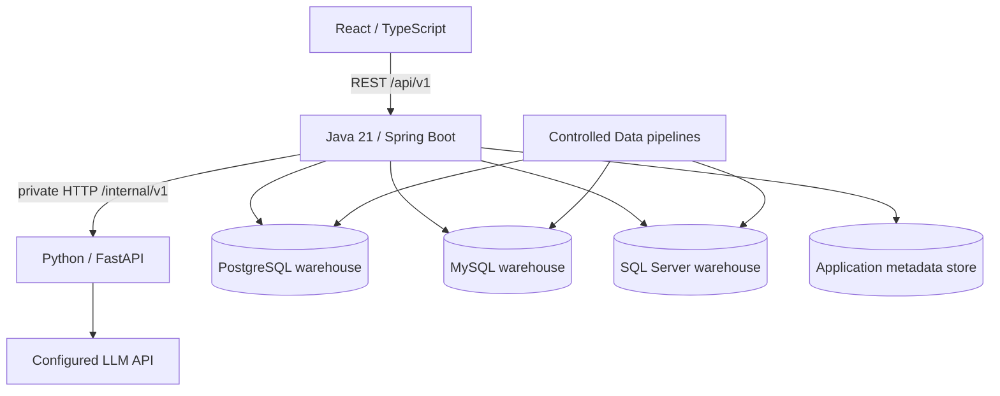

# Kiến trúc và ownership

Application metadata store lưu registry, semantic versions, query history, audit, pipeline/evaluation run; tách rõ khỏi warehouse nguồn. Chọn PostgreSQL làm metadata store cho triển khai; điều này không giới hạn engine warehouse. Flyway app chỉ migrate metadata store; không tự sửa schema warehouse đã đăng ký.

| Phần | Owner | Trách nhiệm |
|---|---|---|
| `frontend/` | React | UX, shell, route, API client, result rendering, MSW, visual checks |
| `backend/` | Java | API, auth, registry, discovery, semantic validation, AST/security, dialect, execution, persistence, evaluation, monitoring |
| `ai-service/` | Python | Internal API, context/few-shot selection, structured output, provider API, deterministic client |
| `data/` | AI/Data phối hợp BE | Canonical demo schema, seeds/generator, ELT, semantic fixtures, evaluation corpus |
| `infra/` | BE phối hợp mọi phần | Compose/network/env/CI; 3 DB engines + 3 application services |
| `docs/contracts/` | Chung | Một nguồn sự thật cho DTO/API/fixtures; review tác động cả ba vai trò |
| `images/`, UI reference | FE | Ảnh gốc, mapping, visual acceptance |

Một warehouse có nhiều dataset; dataset là phạm vi logic có allowlist + semantic layer trên physical metadata, không là một database mới. SQL engine/dialect do warehouse registry xác định; browser không quyết định dialect. Java xác nhận dataset thuộc warehouse và được principal hiện tại phép dùng.

## Query pipeline

Validate principal/warehouse/dataset → snapshot schema/semantic versions → select allowed metadata → call Python → validate JSON → parse SQL AST và resolve identifiers → security/allowlist/dialect checks → safe row/byte/time limits → read-only execution → result metadata + chart validation → history/audit → public Query.

Python không được truy cập JDBC hoặc credential. Python validation chỉ hỗ trợ chất lượng; Java vẫn kiểm tra độc lập. Chart spec là JSON allowlist, không chứa executable code.

## Ingestion khác query

Pipeline quản trị chạy theo cấu hình nguồn đã đăng ký: raw → staging → warehouse → mart. Writer credential tách query runtime; quyền trigger thuộc operator/admin. AI/Data định nghĩa transformation/data-quality, Java orchestrate và lưu run state. Không biến question endpoint hay upload file thành đường ghi dữ liệu.

## Deployment mục tiêu

Compose phải có `postgres`, `mysql`, `sqlserver`, `backend`, `python-ai`, `frontend`; metadata database tách namespace/database với demo warehouse. Chỉ Java public cho API; Python trên private network với service authentication. Pin phiên bản dependency/image khi triển khai. Kiểm tra môi trường host hỗ trợ SQL Server image/Testcontainers; không báo pass nếu engine thật không chạy được, dùng CI host tương thích nếu cần.
