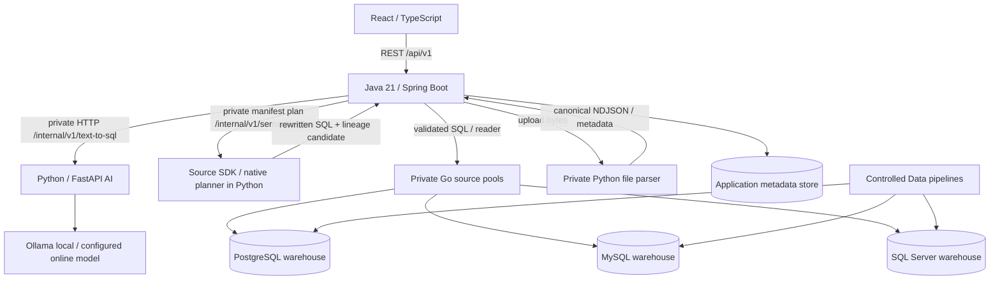

# Kiến trúc và ownership

[Giải thích cơ chế và lần theo code](application-deep-dive.md), [quy trình schema docs/semantic layer](schema-and-semantic-development.md) và [báo cáo readiness](readiness-report-2026-10-22.md) bổ sung hướng dẫn thực hành và giới hạn đã đo.

Application metadata store lưu registry, semantic versions, query history, audit, pipeline/evaluation run; tách rõ khỏi warehouse nguồn. Chọn PostgreSQL làm metadata store cho triển khai; điều này không giới hạn engine warehouse. Flyway app chỉ migrate metadata store; không tự sửa schema warehouse đã đăng ký.

## Định hướng tái sử dụng implementation

Theo yêu cầu ngày 2026-10-20, ưu tiên phần semantic planner/manifest/metadata/connectors và source/tool runtime đã có trong hai snapshot được khảo sát ở [platform-reuse.md](platform-reuse.md). Python hiện tích hợp native Wren planner/rewrite qua private endpoint sau bước sinh candidate. Java vẫn là nơi duy nhất authorize, kiểm tra SQL sau rewrite, so sánh lineage và quyết định thực thi. Không expose MCP/admin/execute tools trực tiếp cho browser/LLM. Danh mục ngoài ba engine hiện tại ở [future-connectors.md](future-connectors.md) là định hướng do người dùng yêu cầu, cần contract migration/capability model và nghiệm thu riêng khi triển khai.

| Phần                    | Owner                | Trách nhiệm                                                                                                                                                                         |
| ----------------------- | -------------------- | ----------------------------------------------------------------------------------------------------------------------------------------------------------------------------------- |
| `frontend/`             | React                | UX, shell, route, API client, result rendering, MSW, visual checks                                                                                                                  |
| `backend/`              | Java                 | API, auth, registry, discovery, semantic validation, AST/security, dialect, execution, persistence, evaluation, monitoring; compiles authorized semantic manifest and calls planner |
| `ai-service/`           | Python               | Internal API, context/few-shot selection, structured provider output, native Wren manifest resolution and SQL rewrite, deterministic client                                         |
| `data/`                 | AI/Data phối hợp BE  | Canonical demo schema, seeds/generator, ELT, semantic fixtures, evaluation corpus                                                                                                   |
| `infra/`                | BE phối hợp mọi phần | Compose/network/env/check runners; 3 DB engines, 5 application services và IdP                                                                                                      |
| `docs/contracts/`       | Chung                | Một nguồn sự thật cho DTO/API/fixtures; review tác động cả ba vai trò                                                                                                               |
| `images/`, UI reference | FE                   | Ảnh gốc, mapping, visual acceptance                                                                                                                                                 |

Một warehouse có nhiều dataset; dataset là phạm vi logic có allowlist + semantic layer trên physical metadata, không là một database mới. SQL engine/dialect do warehouse registry xác định; browser không quyết định dialect. Java xác nhận dataset thuộc warehouse và được principal hiện tại phép dùng.

## Query pipeline

Validate principal/warehouse/dataset → snapshot schema/semantic versions → select allowed metadata → call Python candidate generator → build private manifest from authorized physical context → native Wren resolution/rewrite → validate response → Java parse/resolve/guard rewritten SQL → compare actual physical source set to planner lineage → safe row/byte/time limits → read-only execution → result metadata + chart validation → history/audit → public Query. Planner/LLM errors stop before execution; there is no silent planner bypass.

Python không được truy cập JDBC hoặc credential. Python validation chỉ hỗ trợ chất lượng; Java vẫn kiểm tra độc lập. Chart spec là JSON allowlist, không chứa executable code.

## Ingestion khác query

Pipeline quản trị chạy theo cấu hình nguồn đã đăng ký: raw → staging → warehouse → mart. Writer credential tách query runtime; quyền trigger thuộc operator/admin. AI/Data định nghĩa transformation/data-quality, Java orchestrate và lưu run state. Không biến question endpoint hay upload file thành đường ghi dữ liệu.

## Deployment mục tiêu

Compose phải có `postgres`, `mysql`, `sqlserver`, `backend`, `python-ai`, `frontend`; metadata database tách namespace/database với demo warehouse. Chỉ Java public cho API; Python trên private network với service authentication. Pin phiên bản dependency/image khi triển khai. Kiểm tra môi trường host hỗ trợ SQL Server image/Testcontainers; không báo pass nếu engine thật không chạy được, dùng CI host tương thích nếu cần.

## Workbench cho ngữ nghĩa, tri thức và chuyển đổi

Chi tiết [semantic workbench](semantic-workbench.md), [contract](contracts/semantic-workbench.md). Structured metric selections và ba layer transformations gọi source-fork AST compilers; Python không thực thi warehouse SQL. LanceDB MemoryStore/schema indexer của SDK dùng local embeddings, phân vùng theo identity/dialect/fingerprint và chỉ recall ví dụ còn hợp lệ. Java sở hữu quyền, lifecycle/persistence, reader/import writer, SQL guard và kết quả thật. Transformation preview chỉ SELECT sample; run tạo bốn bảng mới với schema riêng, snapshot/idempotency, bounded async và báo transaction/partial outcome theo engine. Các UI mới gọi cùng Java API; không có đường browser→Python hoặc credentials→LLM.

Online và Ollama profile tách biệt. Volume knowledge tách metadata/warehouse, chỉ Python có quyền ghi. Native vector CPU compatibility phải qua buildgate; source presence không là bằng chứng runtime/caller.

## Provider profiles có quản trị key

Admin Settings tạo profile model qua Java, encrypted-at-rest trong metadata DB bằng AES-GCM, master key do deployment giữ riêng. Query API chỉ nhận providerId cho API mode; Java chốt safe provider snapshot và private modelConfig cho từng request. Python chọn config bằng ContextVar, key chỉ dùng header xác thực provider, không semantic context/prompt/knowledge. Environment fallback được giữ read-only và không sửa file khi admin thay profile. History lưu requested/actual model provenance, không gắn default hiện tại vào snapshot cũ. [Contract](contracts/model-providers.md).

## Chất lượng dữ liệu và inference admission

Quality rules/run snapshots thuộc Java metadata PostgreSQL. React `/quality`→Java xác thực role/resource, resolve exact catalog refs→SqlGuard→native reader executor/source pools của cả3engine. Count/decimal string, full-table bounded aggregates, persisted bounded jobs/restart terminal error và `PER_CHECK` consistency; Python không nhận rows/credentials hoặc tham gia phép kiểm. [Contract](contracts/data-quality.md).

Python generation/semantic-assist có shared process-local active/waiter admission trong tổng deadline, giữ slot qua correction và giải phóng khi cancel/error; không chặn deterministic/native/metric compiler. Bảo vệ tải cục bộ, không giả account-wide rate limiting.
